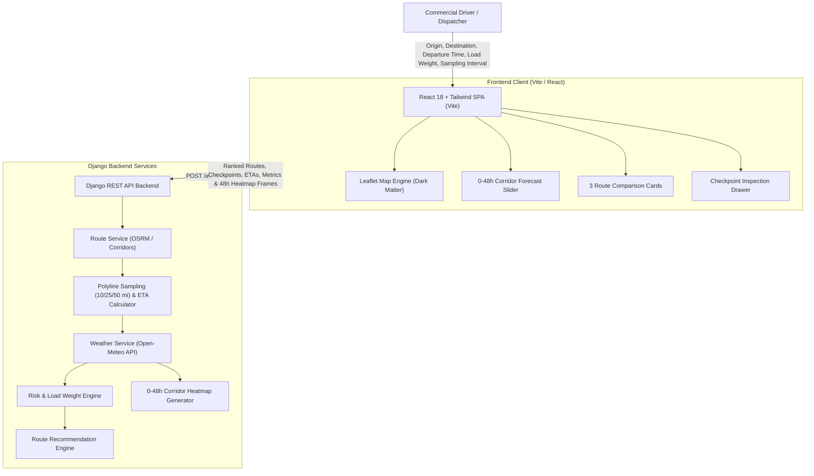

# SafeHaul — Weather-Aware Truck Routing

> A full-stack **React + Django** intelligent route planning application designed for commercial truck drivers and dispatchers. SafeHaul analyzes three distinct multi-corridor routes, samples meteorological forecasts at the truck's exact estimated arrival time (ETA) at 10/25/50-mile checkpoints, evaluates compound weather hazard rules adjusted for truck gross load weights, recommends the optimal path balancing safety and transit time, and renders an interactive 0–48 hour forecast heatmap along the trip corridor.

---

## 🌟 Key Features

1. **3 Multi-Corridor Route Generation**:
   - Generates three distinct commercial corridors via OSRM (Open Source Routing Machine) routing API: Primary Interstate, Divergent Northern Corridor, and Southern Valley Bypass.
   - Fail-safe atmospheric spline generator guarantees continuous operation even if external routing servers face network hiccups.
2. **Dynamic Weather Sampling at Truck ETA**:
   - Accurately samples weather every **10 / 25 / 50 miles** (configurable by the driver).
   - Computes each checkpoint's Estimated Arrival Time (ETA) dynamically based on commercial truck speed profiles and distance along the polyline.
   - Fetches hourly forecasts directly from **Open-Meteo API** (wind speed in mph, rainfall rate in in/hr, snowfall in in/hr, and temperature).
3. **Weight-Aware Weather Risk Engine**:
   - Evaluates base hazards across Wind, Rain, and Snow.
   - Evaluates critical gross load escalation rules (e.g., wind 35–44 mph with load >40,000 lb escalates to Severe; wind 45–54 mph with load >30,000 lb triggers No Travel).
4. **Safety-First Recommendation Algorithm**:
   - Ranks routes based on four lexicographical preferences:
     1. **Fewest Severe miles (and No Travel miles)**
     2. **Fewest High miles**
     3. **Lowest average risk**
     4. **Shortest travel times**
   - Automatically provides human-readable explanations detailing the exact hazards avoided.
5. **Interactive Dark-Themed Map & 0–48h Forecast Slider**:
   - Leaflet map rendering all three routes simultaneously with color-coded risk segments.
   - Interactive checkpoint pins with popups showing ETA, wind, rain, snow, and triggered load factors.
   - **0–48 Hour Trip Corridor Heatmap**: Scrub the slider or press Play to watch weather fronts and hazard fields evolve in real time over 48 hours.

---

## 📐 Architecture & System Flow



---

## 🚦 Risk Rules & Load Weight Thresholds

### 1. Meteorological Condition Thresholds
| Condition | Low | Moderate | High | Severe | No Travel |
| :--- | :---: | :---: | :---: | :---: | :---: |
| **Wind** | &lt;25 mph | 25–34 mph | 35–44 mph | 45–54 mph | **≥55 mph** |
| **Rain** | &lt;0.10 in/hr | 0.10–0.25 in/hr | 0.25–0.50 in/hr | 0.50–1.00 in/hr | **&gt;1.00 in/hr** |
| **Snow** | &lt;0.5 in/hr | 0.5–1.0 in/hr | 1.0–2.0 in/hr | 2.0–3.0 in/hr | **&gt;3.0 in/hr** |

### 2. Truck Load Weight Escalation Rules
* **≥55 mph Wind**: Triggers **No Travel** for *any* load weight (imminent blow-over risk).
* **45–54 mph Wind + &gt;30,000 lb Load**: Escalates from Severe to **No Travel** (heavy trailer lateral displacement).
* **35–44 mph Wind + &gt;40,000 lb Load**: Escalates from High to **Severe** (crosswind control hazard on bridges/open plains).

### 3. Route Recommendation Preference Priority
When comparing route options, the system lexicographically optimizes in order:
1. **Fewest Severe miles (and No Travel miles)**
2. **Fewest High miles**
3. **Lowest average risk score (0 to 4.0 scale)**
4. **Shortest travel times**

---

## 🚀 Quickstart & Setup

### Prerequisites
- **Python 3.11+**
- **Node.js 18+** & **npm**
- (Optional) **Docker**

---

### Option 1: One-Command Startup (Unified Server)
The easiest way to run the entire unified stack on port `8000`:
```bash
# Clone the repository
git clone <repo-url>
cd assessment

# Run the startup script
./start.sh
```
Open [http://localhost:8000](http://localhost:8000) in your browser.

---

### Option 2: Development Mode (Hot Reload)

#### 1. Backend Setup
```bash
cd backend
python3 -m venv .venv
source .venv/bin/activate
pip install -r requirements.txt
python manage.py migrate
python manage.py runserver 127.0.0.1:8000
```

#### 2. Frontend Setup
In a separate terminal:
```bash
cd frontend
npm install
npm run dev
```
Open [http://localhost:5173](http://localhost:5173). The Vite dev server proxies `/api` requests directly to `http://127.0.0.1:8000`.

---

### Option 3: Docker Deployment
Run using Docker Compose:
```bash
docker compose up --build
```
Access the application at [http://localhost:8000](http://localhost:8000).

---

## 🧪 Automated Test Suite

Run the full Django test suite verifying boundary conditions, load escalation rules, recommendation sorting, and API endpoints:
```bash
cd backend
python manage.py test
```

Test coverage includes:
- Wind, rain, and snow threshold classification
- Weight rule escalations (≥55 mph, 45–54 mph + >30k lb, 35–44 mph + >40k lb)
- Lexicographical route recommendation hierarchy
- Geocoding and route calculation endpoints

---

## 🗺️ API Documentation

### `POST /api/routes/`
Computes 3 route alternatives with weather sampling, risk analysis, and corridor heatmap.

**Request Body:**
```json
{
  "origin": { "name": "Chicago, IL", "lat": 41.8781, "lng": -87.6298 },
  "destination": { "name": "Denver, CO", "lat": 39.7392, "lng": -104.9903 },
  "departure_time": "2026-11-13T16:00:00",
  "load_weight": 42000,
  "sample_interval_miles": 25
}
```

**Response Summary:**
- `best_route_id`: ID of the recommended route (#1).
- `routes`: Array of 3 route objects with `distance_miles`, `duration_hours`, `metrics` (`no_travel_miles`, `severe_miles`, `high_miles`, `moderate_miles`, `low_miles`, `average_risk_score`), `recommendation_badge`, `recommendation_reason`, and `checkpoints`.
- `corridor_heatmap`: Object containing `time_labels` and `frames` for hours `0` through `48`, where each frame lists `[lat, lng, risk_score, wind_mph, precip_in, intensity]`.

### `GET /api/geocode/?q=Denver`
Searches places and freight hubs with coordinate resolution.

---

## 📹 5–10 Minute Loom Walkthrough Script

Use this structured script for recording the Loom walkthrough video:

* **0:00 – 1:00 | Introduction & Problem Overview**:
  - Introduce **SafeHaul**: An intelligent weather-aware dispatch tool solving commercial truck routing hazards (crosswinds, ice, snowstorms, and weight blow-over limits).
  - Highlight the stack: **React 18** (Vite + Tailwind CSS + Leaflet) and **Django REST Framework** + **Open-Meteo** + **OSRM**.
* **1:00 – 2:30 | Input Parameters & Weight Escalation Rules**:
  - Show the input panel: Enter Origin (*Chicago, IL*) and Destination (*Denver, CO*).
  - Demonstrate the **Departure Date/Time** picker and quick shortcuts (+2h, Tomorrow 6am).
  - Explain the **Load Weight** selector: Enter **42,000 lbs**. Open the *Risk Classification & Load Rules* drawer to demonstrate how the weight dynamically highlights the active **>40,000 lb** escalation rule.
  - Explain the **Sampling Interval** toggle (10 / 25 / 50 miles) and set it to 25 miles.
* **2:30 – 4:30 | Route Options & Recommendation Logic**:
  - Click **Calculate Safest Route**.
  - Show the 3 generated route options: Primary Interstate, Northern Alternate, and Southern Valley Bypass.
  - Walk through the **#1 RECOMMENDED** badge vs **#2 RUNNER UP** and **#3 ELEVATED RISK**.
  - Explain the risk bar breakdown: exact miles in Low, Moderate, High, Severe, and No Travel.
  - Show how the algorithm strictly enforced preference: lowest Severe miles, lowest High miles, lowest average risk score, and shortest travel time.
* **4:30 – 6:30 | Map Interaction & Checkpoint ETAs**:
  - Inspect the dark-mode Leaflet map: Point out the color-coded polyline segments reflecting real-time risk.
  - Click on several checkpoint circles along the route:
    - Point out the checkpoint ETA (e.g. *Mile 125, ETA Nov 13, 6:45 PM*).
    - Note the meteorological values: temperature, wind speed (mph), rain rate, and snow rate.
    - Point out the active load rule tag explaining why a 38 mph wind with a 42,000 lb trailer was escalated to *Severe*.
  - Open the **Checkpoints Drawer** to show the tabular view with risk filtering (All, Hazard, Severe, No Travel).
* **6:30 – 8:30 | 0–48 Hour Corridor Forecast Heatmap**:
  - Focus on the **Trip Corridor Forecast Slider** at the bottom of the map.
  - Press the **Play** button: Watch the animated weather system traverse the 48-hour corridor across the Midwest and Great Plains.
  - Switch heatmap metrics between *Risk Level*, *Wind mph*, and *Precip / Snow*.
  - Show how dispatchers can advance the slider to identify optimal departure windows.
* **8:30 – 9:30 | Code Quality, Tests & Conclusion**:
  - Show the clean backend architecture: `risk_engine.py`, `route_service.py`, `weather_service.py`, `recommendation.py`.
  - Show passing tests (`python manage.py test`).
  - Summarize hosting and deployment readiness via Docker and single-server build.
